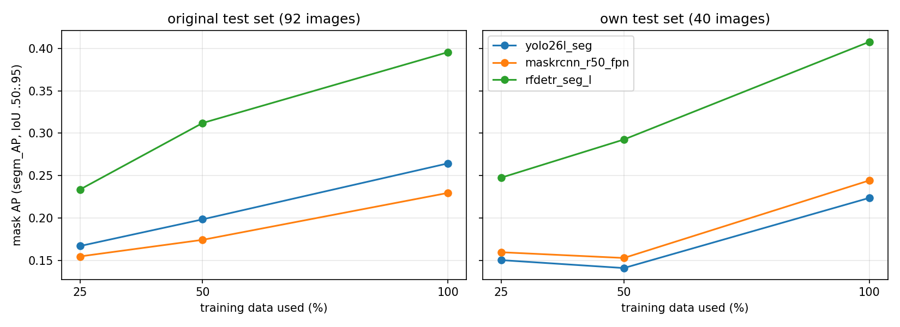

# Panoptic Indoor Instance Segmentation

Tugas segmentasi instance pada citra ruangan dalam. Empat model dilatih di Kaggle (2x T4) pada dataset panoptic indoor
(74 kelas) dengan variabel eksperimen **proporsi data latih (25%, 50%, 100%)**. Model yang selesai dilatih dievaluasi pada
test set dataset asli dan pada 40 foto test set buatan sendiri.

## Struktur repositori

```
training/                 notebook Kaggle, builder notebook, dan kode training (src/)
training_results/         konfigurasi, split data, log training, metrik test per eksperimen, results.csv
wandb/                    script export W&B dan riwayat metrik setiap run (wandb_export/)
test_set/                 40 foto test set sendiri (EXIF asli), label, data.yaml, foto GPS Map Camera
evaluation/               notebook evaluasi dan hasil pada test set asli dan test set sendiri
demo/                     notebook inferensi foto baru (demo_inference.ipynb), foto di demo/photos/
bukti/                    screenshot proses anotasi
ai_usage/                 screenshot penggunaan asisten AI
```

## Dataset dan split

- 922 gambar, 74 kelas (thing dan stuff), format YOLOv8 segmentation. Dataset di Kaggle:
  `jeremymattathiasmboe/panoptic-indoor-dataset-instance-segmentation`.
- Split tetap dengan seed 42 (`training_results/splits.json`): 92 gambar validasi, 92 gambar test, 738 gambar pool latih.
- Subset latih bersarang: 25% = 184 gambar, 50% = 369 gambar, 100% = 738 gambar.

## Model dan konfigurasi

| Model | Keluarga | Status |
|---|---|---|
| YOLO26l-seg | CNN | selesai |
| Mask R-CNN R50-FPN | CNN | selesai |
| RF-DETR-Seg-L | Transformer | selesai |
| Mask2Former Swin-T | Transformer | gagal, CUDA OOM di T4 setelah 1 sampai 4 epoch |

Konfigurasi yang sama untuk semua model (`training_results/exp_config.json`):

- anggaran tetap 4000 langkah optimizer dengan batch efektif 8, sehingga jumlah epoch mengikuti ukuran subset
  (174 epoch untuk 25%, 86 epoch untuk 50%, 44 epoch untuk 100%)
- resolusi 672, augmentasi flip horizontal dan scale jitter, mixed precision
- checkpoint terbaik dipilih dari data validasi
- evaluasi pycocotools `segm` dengan skor minimum 0.001 dan maksimal 100 deteksi per gambar

Log training ada di `training_results/logs/`, riwayat metrik W&B ada di `wandb/wandb_export/`, dan link run W&B ada di
`training_results/wandb_runs.csv`.

## Hasil

Mask AP (segm_AP, IoU 0.50:0.95) pada test set asli (92 gambar) dan test set sendiri (40 foto):

| Model | 25% asli | 25% sendiri | 50% asli | 50% sendiri | 100% asli | 100% sendiri |
|---|---|---|---|---|---|---|
| YOLO26l-seg | 0.167 | 0.151 | 0.199 | 0.141 | 0.264 | 0.224 |
| Mask R-CNN R50-FPN | 0.155 | 0.160 | 0.174 | 0.153 | 0.230 | 0.244 |
| RF-DETR-Seg-L | 0.234 | 0.248 | 0.312 | 0.293 | 0.396 | 0.408 |



Metrik lengkap (AP50, AP75, AP per ukuran objek, AR, AP thing dan stuff, FPS) ada di `evaluation/summary_both_test_sets.csv`.
AP per kelas dan gambar hasil prediksi setiap model ada di `evaluation/results_original_test/` dan
`evaluation/results_own_test/`, dengan susunan `split_{persen}/{model}/`.

## Test set sendiri

- 40 foto ruangan nyata dari kamera HP sendiri dengan metadata EXIF asli (satu foto kiriman WhatsApp tidak memiliki EXIF).
- Foto dari aplikasi GPS Map Camera di `test_set/gps_map/` sebagai bukti lokasi pengambilan.
- Label dibuat dengan bantuan SAM2 lalu direvisi manual di Roboflow, dengan 74 kelas yang sama seperti dataset
  (384 instance, 39 kelas muncul). Screenshot proses anotasi ada di `bukti/`.

## Menjalankan ulang

- **Training**: buka `training/train_instance_seg_kaggle.ipynb` di Kaggle dengan akselerator GPU T4 x2 dan dataset di atas,
  tambahkan secret `WANDB_API_KEY`, lalu jalankan. Notebook dapat dibuat ulang dari `training/src/` dengan
  `python training/build_notebook.py`.
- **Evaluasi**: letakkan dataset di `dataset/` dan checkpoint `best.pt` atau `best.pth` dari output Kaggle di
  `training_results/split_{persen}/{model}/`, lalu jalankan `evaluation/evaluate_models.ipynb`. Checkpoint tidak
  disertakan di repositori karena ukurannya besar.
- **Export W&B**: `wandb login`, lalu `python wandb/export_wandb.py`.
- **Analisis test set sendiri**: setelah evaluasi, `python evaluation/own_test_analysis.py` menjalankan ulang prediksi,
  menghitung AP per subset kondisi sulit (`test_set/hard_conditions.csv`), status kegagalan per instance, eksperimen
  simulasi cahaya rendah, dan grafik laporan. Hasilnya ada di `evaluation/analysis_own_test/`.
